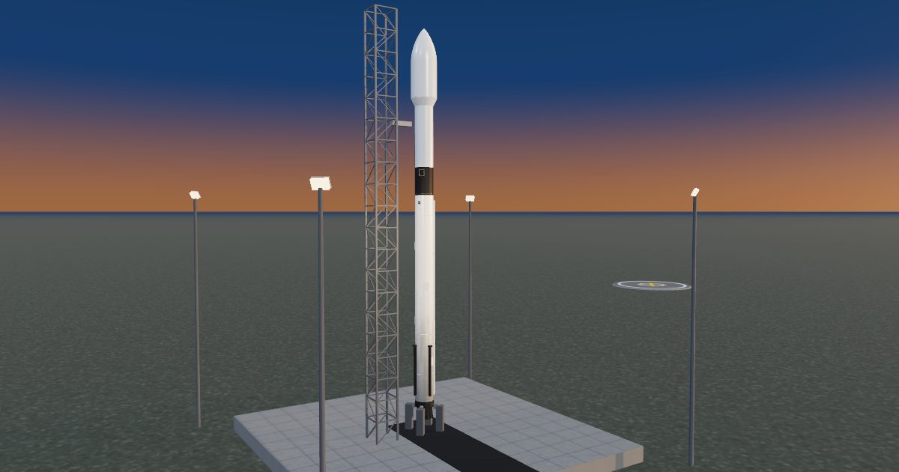

# Vetor-2: foguete 3D interativo



Um foguete de dois estágios em 3D, feito para rodar direto no navegador. Gire, aproxime,
toque nas peças para saber o que cada uma faz e aperte **Lançar** para ver a contagem
regressiva, a ignição, a decolagem, o corte dos motores, a separação dos estágios e o pouso
do primeiro estágio na zona de pouso.

O foguete é inspirado nos lançadores reutilizáveis de dois estágios, mas o nome, as marcas e o
modelo são originais. Todo o 3D é feito com código (sem arquivos de modelo externos).

**Demonstração:** https://lenincsantiago.github.io/foguete-3d-interativo/
(funciona depois que o GitHub Pages estiver ativado; veja [Publicar no GitHub Pages](#publicar-no-github-pages)).

## O que tem

- Foguete com primeiro e segundo estágio, carenagem, interestágio, nove motores, aletas de
  grade, pernas de pouso, juntas de solda, parafusos e painéis.
- Materiais realistas: pintura com verniz, metal, fibra de carbono e vidro.
- Base de lançamento com calha de chamas, torre de serviço, refletores e zona de pouso.
- Céu de amanhecer, sol com sombras, chama com shader próprio, fumaça com partículas,
  ondas de calor e brilho (bloom) só na chama.
- Lançamento completo numa linha do tempo que pode ser pausada e reiniciada, com altitude e
  velocidade na tela.
- Painel de informações ao clicar em cada peça e uma lista de peças para teclado e leitor de tela.
- Funciona no celular e no computador, com qualidade automática conforme o aparelho.
- Respeita a opção do sistema "reduzir movimento" (a câmera corta em vez de deslizar).
- Interface em português.

## Como instalar e rodar

Não precisa instalar nada além de um servidor local simples. O navegador não deixa abrir
módulos JavaScript com duplo clique no arquivo (`file://`), por isso o servidor é necessário.

**Requisitos**

- Um navegador atual com WebGL 2 (Chrome, Edge, Firefox ou Safari recentes).
- Python 3 **ou** Node.js (só para o servidor local).
- Internet: o three.js, o GSAP e as fontes vêm de CDN.

**Passo a passo**

1. Baixe o projeto:

   ```bash
   git clone https://github.com/lenincsantiago/foguete-3d-interativo.git
   cd foguete-3d-interativo
   ```

   Sem Git? Na página do repositório, clique em **Code → Download ZIP** e descompacte.

2. Inicie um servidor local na pasta do projeto (escolha um):

   ```bash
   python3 -m http.server 8080
   ```

   ```bash
   npx serve -l 8080
   ```

3. Abra no navegador: http://localhost:8080

## Controles

| Ação | Mouse | Toque | Teclado (com a cena em foco) |
|---|---|---|---|
| Girar a câmera | Arrastar | Arrastar com um dedo | Setas |
| Aproximar / afastar | Roda do mouse | Pinça com dois dedos | `+` e `-` |
| Ver informações de uma peça | Clicar na peça | Tocar na peça | Botão **Peças** + `Enter` |
| Lançar / pausar / continuar | Botão **Lançar** | Botão **Lançar** | `L` |
| Reiniciar | Botão **Reiniciar** | Botão **Reiniciar** | `R` |
| Fechar painel ou lista | Botão × | Botão × | `Esc` |

Use `Tab` para chegar à cena e aos botões.

## Estrutura do projeto

```
index.html          página, import map (versões fixas + verificação de integridade) e interface
css/estilo.css      visual da interface (cores, tipografia, layout responsivo)
js/main.js          renderer, câmera, laço de animação e resolução adaptativa
js/qualidade.js     escolhe a qualidade gráfica conforme o aparelho
js/pecas.js         nomes e textos das peças
js/roteiro.js       tempos das fases do voo e formatação da telemetria
js/foguete.js       modelo 3D do foguete
js/plataforma.js    base de lançamento, zona de pouso e chão
js/ambiente.js      céu, sol, sombras e luzes
js/efeitos.js       chama, fumaça, ondas de calor, brilho e antisserrilhado
js/interacao.js     câmera, clique nas peças, painel, lista e teclado
js/lancamento.js    sequência do lançamento (linha do tempo GSAP)
tests/              testes automáticos da lógica (Node.js)
favicon.svg         ícone da aba
og-image.jpg        imagem de pré-visualização ao compartilhar o link
```

## Tecnologias

- HTML5, CSS3 e JavaScript puro (sem framework e sem etapa de build).
- [three.js](https://threejs.org/) 0.187.0
- [GSAP](https://gsap.com/) 3.15.1
- Fonte [Barlow](https://fonts.google.com/specimen/Barlow) (Google Fonts)

As bibliotecas são carregadas por *import map* direto do jsDelivr, com versão fixa e hash de
integridade (SRI): se o arquivo do CDN mudar, o navegador recusa carregar.

## Testes

Os testes cobrem a lógica que não depende do navegador (qualidade gráfica, textos das peças e
roteiro do voo). Precisam do Node.js 22 ou mais novo:

```bash
node --test tests/
```

## Publicar no GitHub Pages

O site é estático, então o GitHub Pages hospeda de graça:

1. No repositório, abra **Settings → Pages**.
2. Em **Build and deployment**, escolha **Deploy from a branch**.
3. Selecione a branch `main` e a pasta `/ (root)` e salve.
4. Em alguns minutos o site estará em
   `https://lenincsantiago.github.io/foguete-3d-interativo/`.

## Desempenho e acessibilidade

- Mais ou menos 60 FPS numa GPU integrada Intel em 1440×900, com resolução adaptativa se o
  aparelho não aguentar.
- Lighthouse 100 em acessibilidade, boas práticas e SEO.
- Pausa o desenho quando a aba fica oculta e libera a memória da GPU ao sair da página.

## Como contribuir

Sugestões e correções são bem-vindas. Abra uma *issue* descrevendo o problema ou a ideia, ou
envie um *pull request*. Antes de enviar, rode os testes (`node --test tests/`) e confira a
página no navegador sem erros no console.

## Licença

[MIT](LICENSE) © 2026 Lenin Cavichioli Santiago. Você pode usar, copiar e modificar,
inclusive em projetos comerciais, desde que mantenha o aviso de licença.
